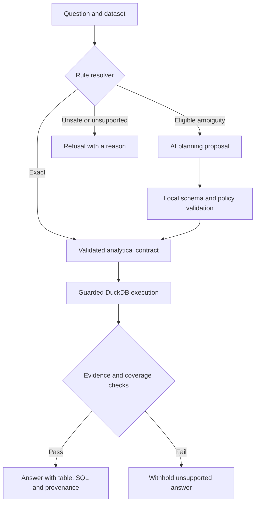

# Agentic Analytics Engine

A Python and SQL application that turns business questions into checked analytical
answers over DuckDB. It supports a built-in demo warehouse and uploaded CSV or
Parquet data. Answers include the query results and provenance used to support them.

**[Live demo](https://agentic-analytics-engine.onrender.com/)** ·
[Walk through the code](docs/WALKTHROUGH.md) · [Setup and deployment](docs/DEPLOYMENT.md)

## The project in one explanation

“I built a question-to-analysis application. Python first tries to interpret the
question using deterministic rules. For supported ambiguities, an AI planner can
propose a structured interpretation. The application validates that interpretation,
builds and executes SQL, and checks the results before showing an answer. The
important separation is that the model helps interpret the request, while code and
DuckDB calculate the numbers and retain the evidence.”

The default development provider is a scripted fake: it exercises the workflow
without an API key. It does not demonstrate real-model accuracy. Cloud planning
requires the configuration described in the deployment guide.

## Follow these four stages

| Stage | Start reading here | Responsibility |
| --- | --- | --- |
| Interpret | [`analytics/upload_plan.py`](src/agentic_analytics/analytics/upload_plan.py) | Resolve an uploaded-data question to a typed query contract |
| Validate and calculate | [`analytics/compute.py`](src/agentic_analytics/analytics/compute.py) | Construct supported analytical operations |
| Execute SQL | [`analytics/execute.py`](src/agentic_analytics/analytics/execute.py) | Guard SQL, bound execution and save result snapshots |
| Verify and present | [`verification/canonical.py`](src/agentic_analytics/verification/canonical.py) | Check the contract and evidence before publication |

These are reading entry points, not four independent scripts. The
[walkthrough](docs/WALKTHROUGH.md) explains the supporting modules and the separate
warehouse workflow.

## How the workflow fits together



The model never executes SQL or supplies published arithmetic. On the upload
path it proposes a typed interpretation; local code validates and computes it.
The warehouse workflow can use bounded model calls for planning, proposed findings
and semantic review, with deterministic publication gates.

## Run locally

Use Python 3.12+ and Node 22 for the web client.

```bash
make bootstrap
make dev
```

`make dev` generates demo data, builds the client and serves
`http://127.0.0.1:8000` in fake-provider mode. Run `make verify` for Python lint,
types, Python tests, frontend checks and recording validation. Browser, Docker
and dependency-audit checks are separate targets listed by `make help`.

## What is preserved

- Typed analytical contracts, schema validation and conservative ambiguity handling.
- Guarded SQL, locked DuckDB connections and deterministic metric/statistical calculations.
- Coverage checks, cited result cells and traceable result snapshots.
- CSV/Parquet upload sessions, the React client, API and MCP tool boundary.
- Cloud-provider controls and the shared usage ledger when cloud mode is enabled.

A cloud planner receives **the question, schema information and aggregate labels**,
not unaggregated rows. Near-unique text fields are withheld from grouping. Column
roles that the data cannot establish require session-scoped confirmation.

## Limits and further reading

This is a bounded analytics application: it does not support arbitrary joins,
forecasts or causal conclusions. A refusal is preferable to silently answering a
different question. Session capabilities isolate data but are not user accounts.

- [Code walkthrough and example](docs/WALKTHROUGH.md)
- [Architecture](docs/ARCHITECTURE.md) and [limitations](docs/LIMITATIONS.md)
- [Evaluation](docs/EVALUATION.md) and [deployment](docs/DEPLOYMENT.md)
- [Documentation map](docs/README.md) and [historical evidence](docs/HISTORY.md)

MIT licensed.
