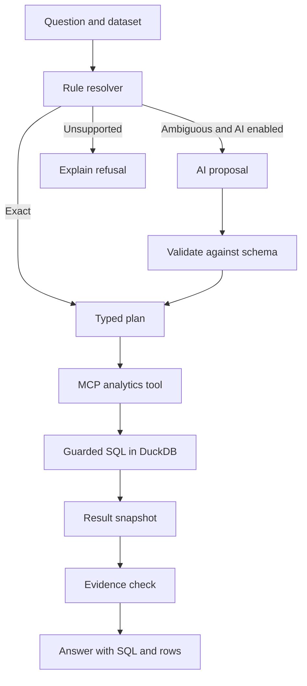

# Agentic Analytics Engine — compact edition

A small interview friendly analytics app built with Python, DuckDB, LangGraph, and the MCP Python SDK. It accepts one CSV or Parquet table (or the included demo), interprets a business question, executes a controlled SQL aggregate, and publishes the result alongside the exact SQL and an MCP tool trace. Optional AI can propose a structured plan for an ambiguous question; the normal demo does not require an API key.

## Explain it in one minute

I built a question to SQL analytics workflow. Python rules identify the requested operation, measure, grouping, and time field. When the wording is clear, no model call is needed. For a genuine ambiguity, an optional AI planner proposes a typed mapping, which is checked against the dataset and the question. A LangGraph workflow invokes an in process MCP analytics tool; that tool builds and validates read only SQL, calculates the result in DuckDB, and records a result snapshot. A final check ensures the answer uses only returned values. The public demo runs without paid AI.

## Read these files in order

1. `engine.py`: load data, interpret questions, construct SQL, execute, and verify.
2. `mcp_server.py`: four typed MCP tools around the engine.
3. `workflow.py`: three LangGraph nodes, optional AI proposal, MCP client call.
4. `app.py`: FastAPI endpoints and session handling.
5. `static/index.html`: small browser interface.
6. `tests/test_engine.py`: examples and important refusal cases.

## Flow



Try: **What are total sales by region?**, **What is average sales by category?**, or **Show monthly sales over time**.

## Run

Requires Python 3.12+.

```bash
pip install -r requirements.txt
uvicorn app:app --reload
```

Open http://127.0.0.1:8000 and load the demo. Run `pytest -q` for focused checks.

To enable optional AI interpretation, set `AAE_AI_ENABLED=true`, `AAE_AI_API_KEY`, and `AAE_AI_MODEL`. The AI receives the question and column names/types, not uploaded rows. The model only proposes a mapping; code validates and calculates it. Keep AI disabled for the public anonymous demo unless you add durable quotas and a provider spending cap.

## Render

The included `render.yaml` builds the Dockerfile as one web service. After changing the connected Render service to the new commit, deploy manually and check `/api/ready`. The original project is preserved on branch `archive/full-agentic-engine-2026-11-03`.

## Deliberate scope

This edition supports one table, count, sum, average, top or bottom ranking, and monthly trends, plus a correlation tool. It refuses unsupported requests rather than guessing. It does not claim arbitrary joins, forecasting, causal analysis, enterprise authentication, or proven real model accuracy. Uploaded sessions live in memory and disappear on restart. The four MCP tools are invoked in process; the public app does not expose an unauthenticated remote MCP endpoint.
